# PadelPro

> This repository is a showcase: screenshots and an overview. The source code is private. I'm happy to walk through it on request.

A booking marketplace for padel courts, built for the Iranian market: persian-language, right-to-left, Jalali calendar, prices in rial. Players book courts online, join open matches and split the bill, and build a verified ranking. Coaches run their students from their own desk, and clubs and admins get their own panels.

I built it alone over about ten weeks (340+ commits, August to October 2026). It is a full product rather than a demo: real double-entry accounting, a rating system, four role-based dashboards and a deploy pipeline.

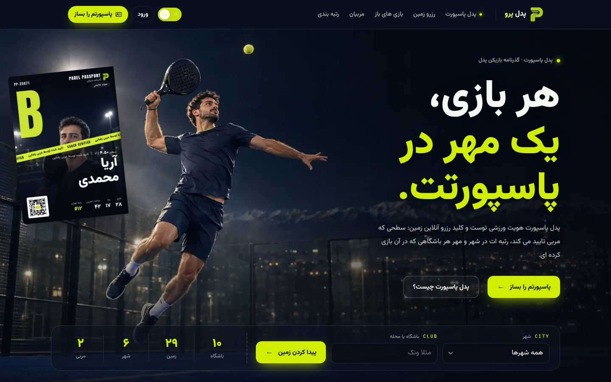

## What it does

- **Court booking.** A club's schedule grid shows every slot as free, held, booked or past. You pick slots, pay, and get a ticket. Two people can never hold the same court at the same time (more on how below).
- **Padel Passport.** A player identity card: level, official games, city, and which coach verified the level. A passport is the key to online booking and is the main thing the platform sells.
- **Open matches.** Book a court, leave the empty spots open. Players at the right level join and each pays only their own share.
- **Ranking.** Elo-based. Ratings come only from confirmed match results, never from self-reports.
- **Training log.** A player logs a session with its start and end time and their coach; the coach approves it, and only approved hours count on the passport.
- **Coach desk.** Coaches are validated by a club (Coach ID). From their desk they approve classes, announce drills and match games to a group or chosen students (who answer «coming / not coming»), set a Drill and a Game Match rate per student, keep each student's account (charges from approved hours, deposits the student records and the coach confirms), organise students into groups, book free courts that the club bills them for, run competitions with entry fees and prizes, and read one report with all their money.
- **Four panels.** Player, coach, club and admin, each with its own colour and navigation, built from one shared shell.

| Booking a court | Passport |
|---|---|
| 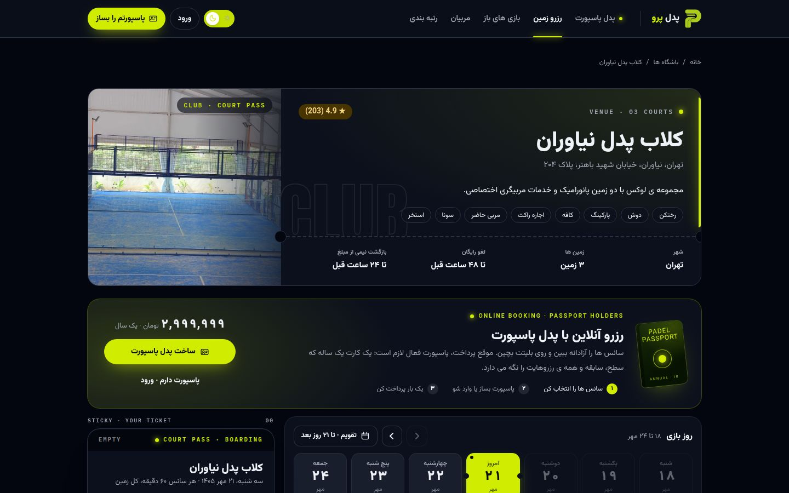 |  |

| Player dashboard | Player finance |
|---|---|
| 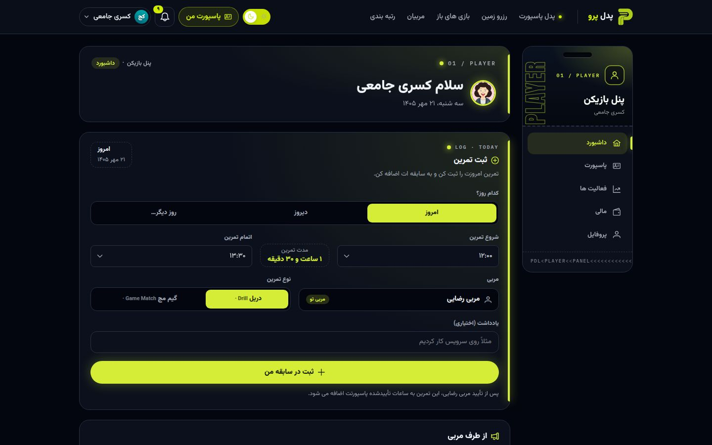 | 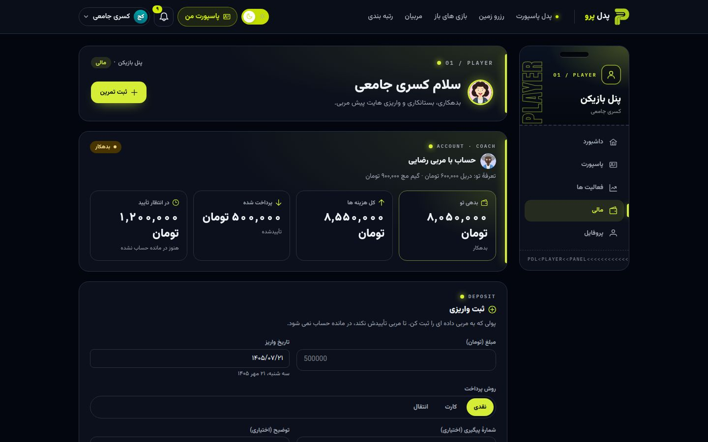 |

| Coach desk | Students and rates |
|---|---|
| 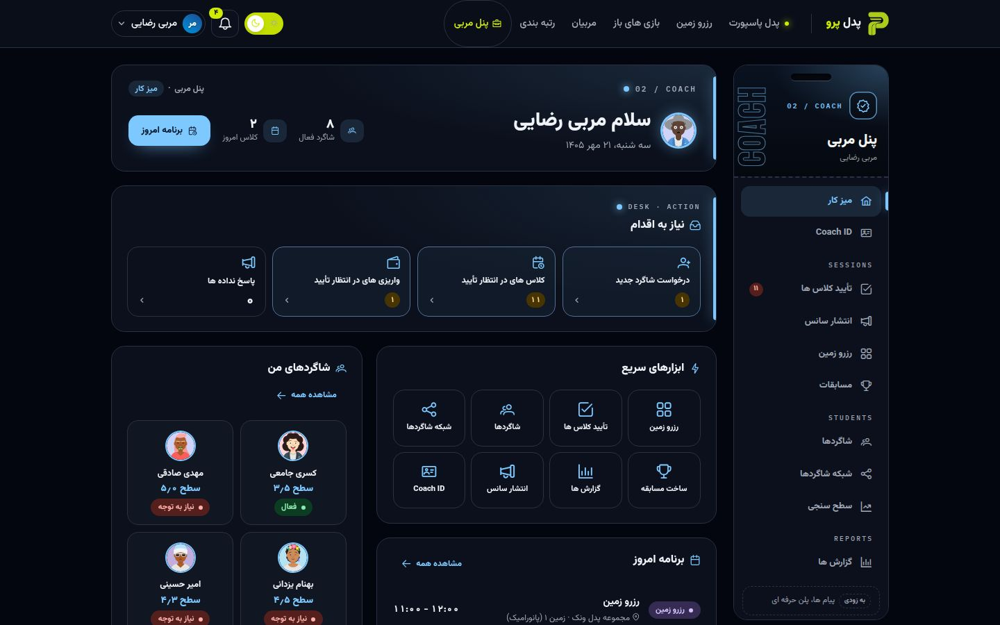 | 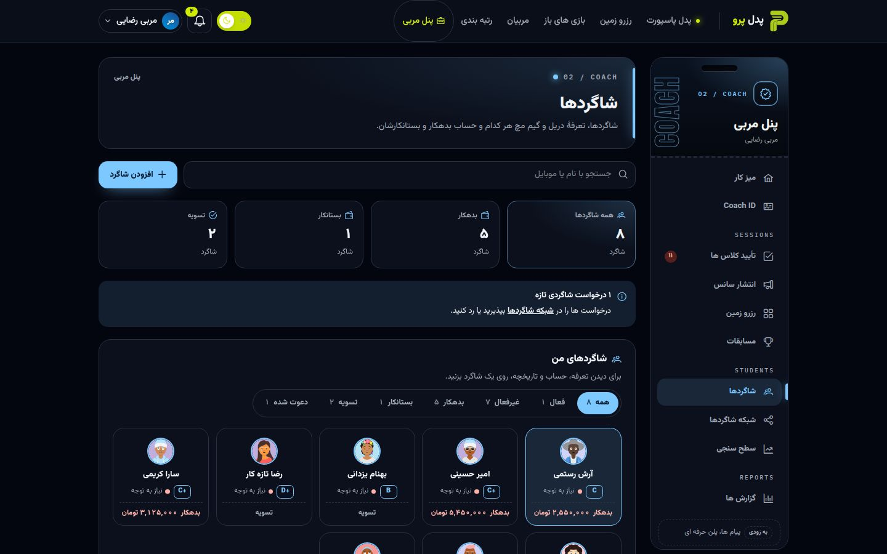 |

| Announcing a session | Booking a court as a coach |
|---|---|
| 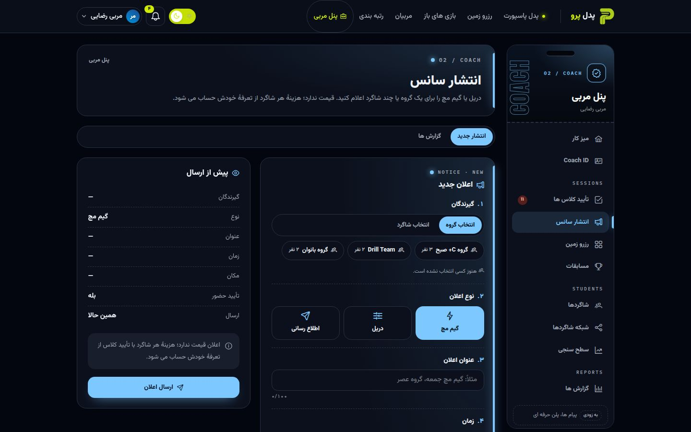 | 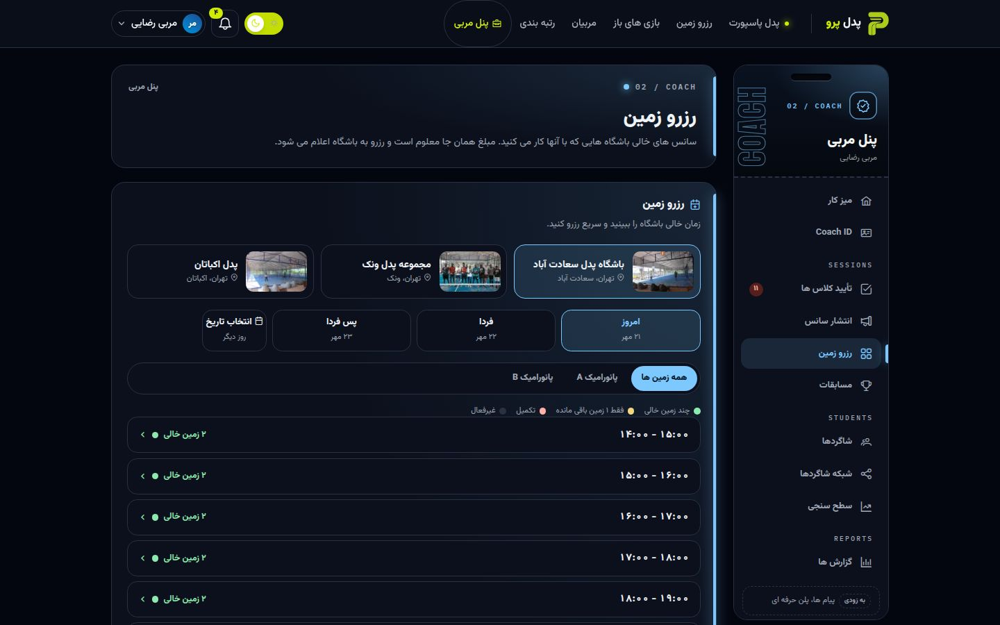 |

| Coach report | Ranking |
|---|---|
| 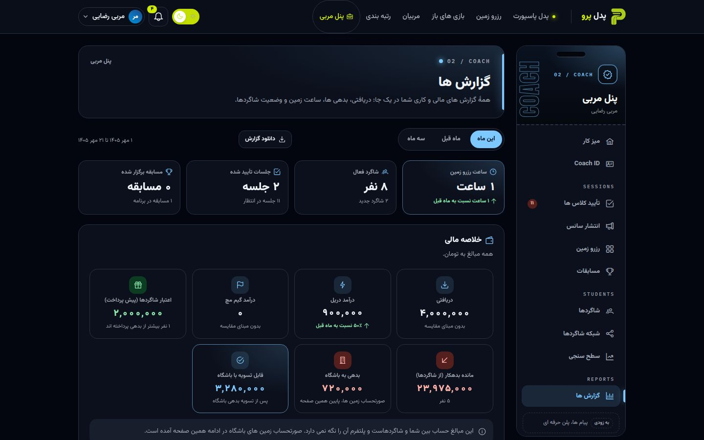 | 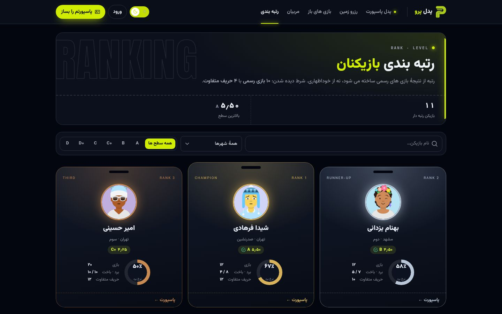 |

| Club panel | Admin panel |
|---|---|
| 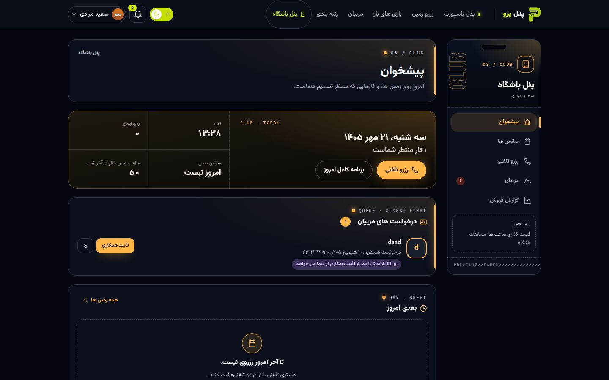 | 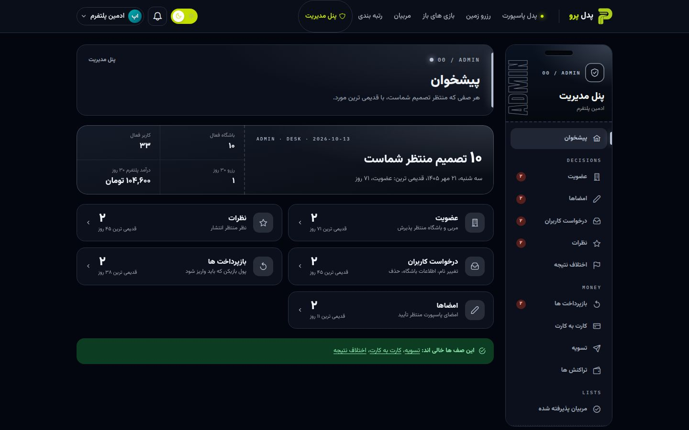 |

It works on phones too (bottom navigation, one court at a time instead of the wide grid):

  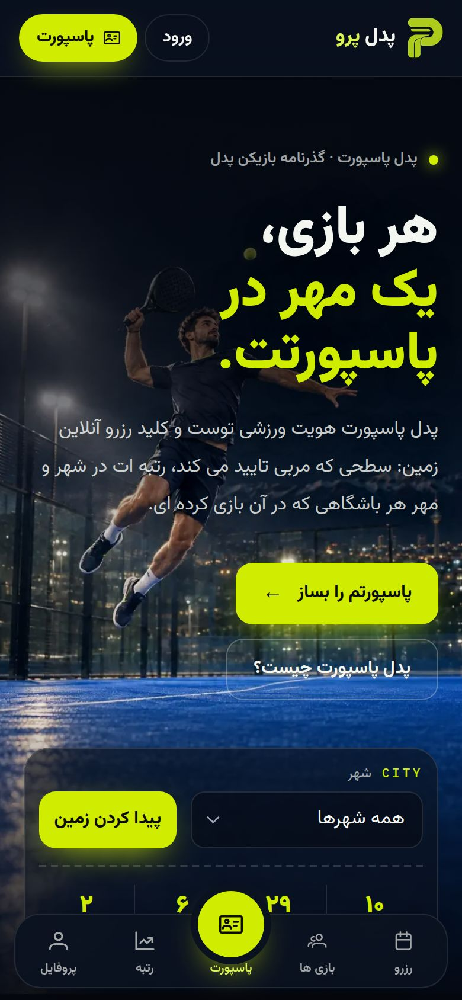
  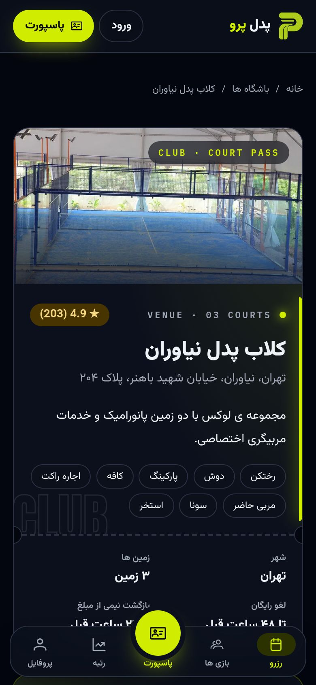
  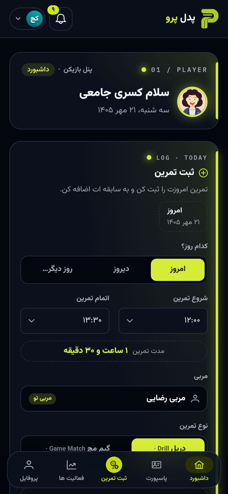
  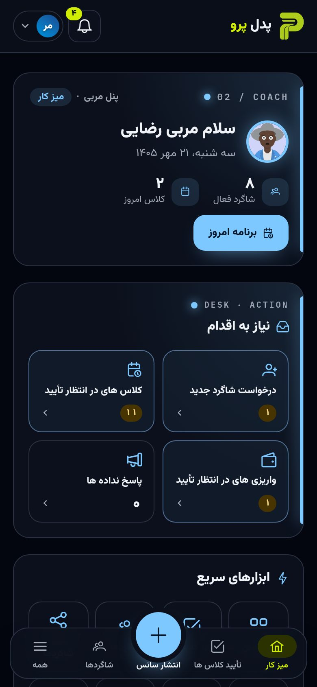

## The parts I'm most happy with

**Double booking is prevented by the database.** A Redis lock makes the UI feel instant, but Redis can restart or evict keys, and then two payments land on one court. So the real guarantee is a Postgres `EXCLUDE USING gist` constraint on the bookings table. The readiness endpoint refuses to report "ready" if that constraint is missing. I tested it against eleven SQL scenarios.

**There is no balance column.** Every rial movement is a row in a double-entry ledger, and a balance is always a sum. Each transaction must add up to zero, and a nightly job checks it. It is more work than a column, but it means a wallet number can never silently disagree with what happened.

**Money and rating logic are pure packages.** `packages/pricing` and `packages/rating` do no I/O at all, so they are easy to test hard. Both have an 85% coverage threshold, because a quiet regression in either one is the kind that costs real money or trust.

**A coach's money is not the platform's money.** What a student owes their coach is settled between the two of them, so it lives in its own account table and never touches the platform ledger. An approved hour is charged once at that student's rate (the row is unique per training log), a competition entry is charged on sign-up and voided if the competition is cancelled, and a deposit only counts after the coach confirms it. Adding a student is an invitation the player has to accept, because being someone's student means being charged.

**Two rating scales.** Elo runs on 800 to 2200 internally, and players see a 0 to 7 level. Running Elo directly on 0 to 7 does not work: a two-level gap would give a 50.3% win chance. A letter grade (D to A) is derived for display only and never feeds back into any formula.

**Persian details done properly.** Everything is stored as UTC `timestamptz` and money as integer rial (`BIGINT`). Jalali dates are a display concern only, and opening hours are resolved in `Asia/Tehran`. Layout uses logical CSS properties, so RTL is one attribute on `<html>`.

**Smaller things:** feature flags in the database (paid coach sessions are switched off with one row), scheduled notices sent by a cron job that claims each one with a conditional update, per-identity rate limiting, a nonce-based CSP and the usual security headers, idempotency keys on payment endpoints, refresh-token rotation with compare-and-set, and a JS budget on the home page that is checked by a script (about 192 KB gzipped of a 196.6 KB limit).

Every non-obvious choice has a written reason in a decision log (20 records).

## Stack

| | |
|---|---|
| Frontend | Next.js 16 (App Router), React 19, Tailwind v4, PrimeReact (unstyled, themed through PassThrough) |
| Backend | NestJS 10, REST and Socket.io, Zod validation shared with the frontend |
| Data | PostgreSQL 16 with Prisma, Redis 7 |
| Payments | Mock gateways for demos plus a real ZarinPal v4 driver |
| Tooling | npm workspaces, Vitest, type-aware ESLint, Docker, nginx |

## Numbers

| | |
|---|---|
| Source | about 92,000 lines of TypeScript, 54 pages |
| API | 22 controllers, about 200 route handlers |
| Database | 36 migrations |
| Tests | 533 across 54 files, all passing; lint has no errors |

## Status and what's next

The core product is finished and runs end to end. It is deployed as a demo with mock payments. What is left is outside the code: a real payment-gateway contract, SMS provider and a domain, plus testing on real iOS devices. The English version of the site is partly done (home and role pages), and club-wide tournaments and leagues are planned for later. There is also a written business plan covering the market, competitors and unit economics.

## خلاصه به فارسی

پدل‌پرو یک پلتفرم رزرو زمین پدل برای بازار ایران است: رزرو آنلاین، بازی‌های باز با پرداخت تقسیمی، رتبه‌بندی بر پایه‌ی نتیجه‌ی تأییدشده، میز کار مربی (تأیید کلاس، انتشار سانس، تعرفه و حساب هر شاگرد، گروه‌ها، رزرو زمین، مسابقه و گزارش)، و پنل جدا برای بازیکن، مربی، باشگاه و ادمین. رابط فارسی و راست‌به‌چپ است، تقویم شمسی نمایش داده می‌شود و مبلغ‌ها به ریال صحیح ذخیره می‌شوند.

## Author

Kasra Jamei · kasrajamei@yahoo.com
